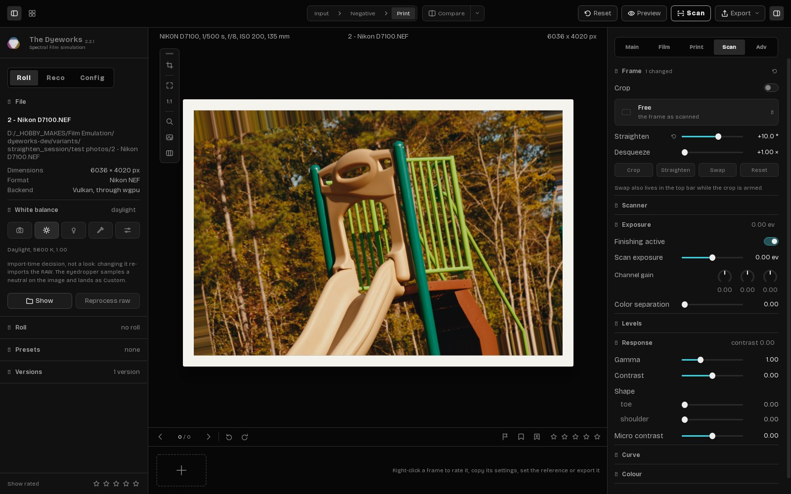
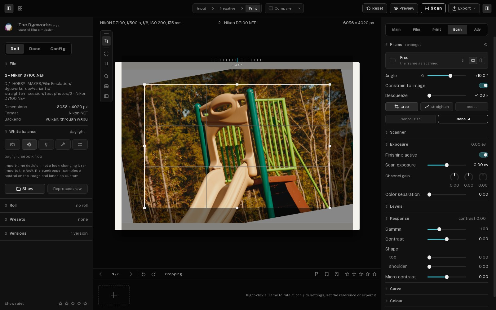
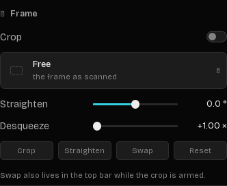
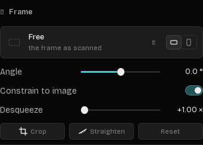
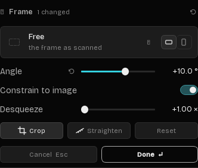

# Crop & straighten: one home for the crop's controls, and nothing applies until Done

**Builds on `patches/crop_white_corners` and `patches/crop_frame_drag`.** Apply their diffs first, then `crop_straighten_session.diff`. The `.py` files here are the full modules after all three, over 2.2.1. The diff is only this change.

Target files (The Dyeworks 2.2.1), all in `src/spektrafilm_gui/`:

- `controller_crop.py` (most of it), `crop_frame.py`
- `scan_sections.py`, `edit_panel.py`, `edit_panel_spec.py`, `dyeworks_widgets.py`, `dyeworks_icons.py`
- `state_bridge.py`, `controller.py`, `controller_history.py`, `controller_presets_canvas.py`, `controller_roll.py`
- `viewer_rail.py`, `field_labels.py`, `widget_specs.py`

`app.py` is not touched. `test_straighten_session.py` holds the checks below.

## What is wrong in 2.2.1

1. **A typed angle leaves the corners in.** Typing or sliding Scan › Frame › Straighten (or the Main tab's pinned row) turns the photo with no crop. Only the canvas turn and the straighten line fit one. The empty corners end up in the export: stretched pixels in 2.2.1, white with `crop_white_corners`.
2. **Reset doesn't reset the angle.** After a crop and an angle, Frame › Reset turns the crop off but leaves the photo turned. With the frame armed it only moves the frame on screen, so it seems to do nothing.
3. **The crop's controls are in three places.** Scan › Frame has:
   - a Crop on/off row, which shows **off** while cropping because the crop is lifted to show the whole photo;
   - the ratio list, with six portrait copies (4:5, 9:16, 2:3…) because there is no orientation control;
   - a Straighten slider next to a Straighten button that does something else;
   - Crop, Swap and Reset buttons, and a note saying "Swap also lives in the top bar while the crop is armed".

   The rail has the crop button and a second Swap.
4. **Leaving the crop is unclear.** Enter and Esc work only while the photo has focus, and there is no Cancel or Done on screen. The status line's how-to is cut off mid-word at every window size.
5. **Turning re-renders the scan for every angle,** so the turned photo trails behind the pointer.

## The design

Every control has one home, the way Lightroom Classic, Capture One and Apple Photos split it:

| Where | What |
|---|---|
| **Scan › Frame** (panel) | Aspect ratio, with a landscape / portrait pair at its right end; **Angle** (the old Straighten slider, same field); **Constrain to image**; Desqueeze; **Crop · Straighten · Reset**; and while cropping, **Cancel · Done** under them. Done uses the app's primary button style. |
| **Canvas** | The frame only: handles, drag inside to move, drag outside to turn, the existing ruler. |
| **Rail** | The crop button (start / apply). Its Swap button goes. |

Removed: the panel's Crop on/off row, its Swap button and note, the rail's Swap, and the six portrait ratio presets. The ratio is GUI-only and never stored, so nothing saved changes.

**No new shortcuts.** Enter or a double-click inside the frame is Done, Esc is Cancel, and Shift gives a fine drag, all as in 2.2.1. Two existing keys now also act on an open crop:

- Esc cancels from anywhere in the window. A field, popover or menu that uses Esc keeps it.
- Ctrl+Z cancels the open crop.

## Behaviour

**Opening.** Any of these opens the crop: the rail button; the Crop button; any change to Angle (typed, slid, scrolled, pasted, its reset arrow); a ratio or orientation pick; a straighten line.
- The whole photo shows, turned, with the frame fitted inside it.
- The status line says "Cropping". The how-to moved to the rail button's tooltip, because the status line has ~118 px at the smallest window.
- Started from the rail, the panel shows Scan › Frame, using the top bar's own panel toggle if the panel is closed.

**Nothing applies until Done.**
- **Done** applies the angle and the crop as **one** undo step, with a card: "Straightened 10.0°, cropped to fit", and an Undo button. Done is the button, Enter, a double-click, the Crop or rail button again, or leaving the photo: another frame, a load, Input mode, or a look put back.
- **Cancel** puts the photo back exactly: angle, crop, ratio, orientation and Desqueeze. Cancel is the button, Esc or Ctrl+Z; turning or mirroring the photo also cancels, because the frame was fitted to the photo as it was.

**Reset has one meaning:** no crop, 0°, Free, landscape, and Desqueeze back to its baseline. It is one undo step; inside an open crop it stays pending until Done. The Frame group's header reset arrow does the same.

**Constrain to image** (an app setting, `crop_constrain`, remembered) keeps the frame inside the turned photo. Off, the frame may take in the white corners.

**The frame stays where the user put it.** Each angle fits the frame the user set (`_frame_base_uv`), not the previous fit, so turning back gives the frame back. A crop that only a straighten made goes back to the whole photo when the angle goes back to 0.

**Done keeps the frame exactly.** It writes the frame to the fields' four decimals, rounded to nearest. It moves one step inward only when that rounding would reach past the turned photo. So re-opening a crop and pressing Done again gives the same crop; always stepping inward shrank it on every Crop → Done.

**Turning follows the pointer.** While cropping, the film is rendered once without the turn. Each angle then only turns that frame with the existing skew shader, ~12 ms on the GPU, instead of a render. This works because the turn is the pipeline's last step, on the finished scan. The histogram and thumbnails follow 150 ms after the turning stops.

**A look put back never opens a crop.** Undo, presets, roll frames, versions and pasted looks run inside `state_bridge.restoring()`, so their angle changes are not the user's. An open crop is applied first.

## How it is built

- `controller_crop.py`:
  - the session: `_open_crop_session`, `_arm_crop_frame`, `_frame_commit`, `_frame_cancel`, `apply_crop_session` / `cancel_crop_session`;
  - the fit from the base frame: `_session_fit`, `_refit_session_frame`;
  - Reset: `reset_crop`, `_session_reset`;
  - the stored crop: `_stored_crop`;
  - the real-time turn: `_crop_turn_fast_path`, `_crop_turn_result`, `_turned_result`;
  - `_EscapeCancelsCrop`, the window filter for Esc while a crop is open.

  The fits use the scan's own frame (`_scan_frame_wh`: the input after its crop, desqueezed), not the canvas texture, which is the cropped render while a crop is on.
- `scan_sections.ScanFrameSection`:
  - the buttons `cancel_button`, `done_button`, `constrain_toggle` and the orientation pair;
  - the signals `crop_done_requested`, `crop_cancel_requested`, `constrain_toggled`, `orientation_chosen`, `session_open_changed`, `reveal_requested`.
- `edit_panel.py` / `edit_panel_spec.py`:
  - the Frame group's rows: `Special('constrain')`, and a `btns` row shown only `'while': 'cropping'`;
  - the header reset routed to the group's Reset;
  - showing the group when cropping starts from the rail.
- `state_bridge.py`: `restoring()`, `is_restoring()`, `on_restore()`.
- `controller_history.py`: no snapshots while cropping; `history_flush()`; undo inside a crop is Cancel.
- `controller.py`, `controller_roll.py`, `controller_presets_canvas.py`: the doors out of a photo apply the crop. These are loading another file, switching roll frames and Input mode. Turning and mirroring the photo cancel it. The render path takes the fast turn while cropping.
- `crop_frame.py`: `oriented_ratio` replaces `swap_ratio_label` and the portrait presets.
- `dyeworks_widgets.RatioSelect`: an optional trailing widget, for the orientation pair.
- `dyeworks_icons.py`: `straighten` (ruler), `landscape`, `portrait`.
- `viewer_rail.py`: no Swap button. The `on_swap` argument is still accepted, so `app.py` is unchanged.
- `field_labels.py` and `widget_specs.py`: the label Angle and its tooltip.

Stored fields are unchanged (`scan_finishing.crop`, `crop_center`, `crop_size`, `skew_deg`), and so are versions, presets and roll files.

## Screenshots

The same steps on both builds (2 - Nikon D7100.NEF, 1600 px window): Scan › Frame open, `10` typed into the angle row, Enter.

| 2.2.1 | This change |
|---|---|
|  |  |
|  |   |

In 2.2.1 the photo turns with no crop and its corners fill with stretched edge pixels. With this change the crop opens with the frame fitted inside the turned photo, and Cancel · Done appear under the Frame group's buttons. The status line says "Cropping", and nothing is applied until Done.

## Verification

`python test_straighten_session.py <src dir> <out dir> <raw A> <raw B> [--baseline]` drives the real `GuiController` headless (`QT_QPA_PLATFORM=offscreen`, a throwaway settings file), the way the user does:

- typed angles in the field;
- real clicks on Cancel, Done, Crop, Reset and the orientation pair;
- key presses (Esc, Enter, Ctrl+Z);
- mouse drags on the canvas overlay;
- a drawn straighten line.

"Smear" is measured at full resolution: the scan geometry is rebuilt with a mask that is 0 outside the picture, so every 0 inside the crop is a pixel that would show an empty corner.

| Area | Checks |
|---|---|
| Opening | A typed angle opens the crop, fitted, with nothing applied yet; so do a ratio pick, the orientation pair, a straighten line and the Crop button. Started from the rail, the panel shows Scan › Frame. A look put back (undo, a preset) never opens it. |
| The frame | It refits live and never shrinks from fit to fit. Drags move only the held edge and stop at the photo's edge. Presses near the frame resize it. Turning keeps its centre. The fit uses the scan's own frame (with an input crop and a desqueeze). Constrain off keeps the whole turned photo. Going back to 0° removes a crop that only the straighten made, but not a deliberate trim. |
| Done | It is one undo step, with a card and Undo, and leaves no smear. Enter on a focused panel button does not apply. A full-frame Done with nothing touched is no undo step. Six Crop → Done cycles keep the frame within a pixel of what was set. |
| Cancel | Cancel, Esc and Ctrl+Z put back the angle, crop, ratio and orientation; the Angle row shows the angle put back. Turning or mirroring the photo cancels. |
| Reset | It works after Done and inside a crop (pending), and resets crop, angle, ratio, orientation and Desqueeze as one undo step. The group's header reset does the same. |
| Leaving the photo | A frame switch (auto preview on or off), Input mode or a look put back applies the crop first. A re-decode of the same photo keeps it. The Crop tool or Straighten inside an open crop doesn't re-arm or lose it. |
| Layout | The controls are in Scan › Frame, and nothing but the rail floats over the photo. |
| Rendering | Outside the turned photo is white on the CPU and GPU. One render per angle change. While cropping each angle turns the kept frame instead of rendering. No smear at any angle, crop on or off. |

118 checks, all pass. `--baseline` runs only the smear measurement on 2.2.1: a typed 3.2° leaves 697,788 smeared pixels in the 24 MP frame (2.9%) and 10° leaves 1,961,842 (8.1%), with no crop on. With this change, Done after a typed angle leaves 0 at 14 angles from -33° to 41°, crop on or off before.

Also tested by hand in the app, step by step:
- every way to open, apply and cancel;
- Reset, including Desqueeze;
- orientation;
- leaving the photo;
- real-time turning;
- repeated Crop → Done;
- the narrowest window.
